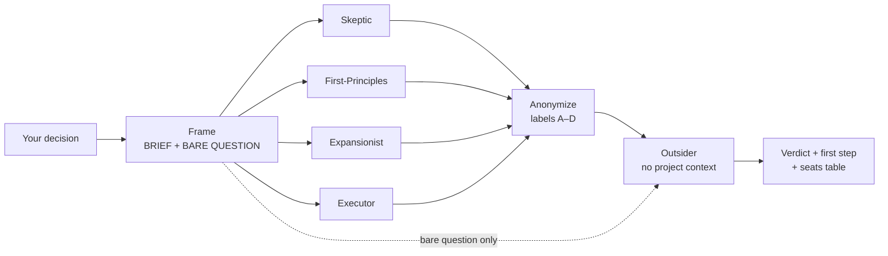

# Prism Council

**Pressure-test a decision with five deliberately opposed AI advisors, then get one direct verdict.**

[](LICENSE)
[](https://agentskills.io/specification)

**English** · [فارسی](#fa)

Prism Council is an [Agent Skill](https://agentskills.io) for AI coding agents such as Claude Code, Codex, Cursor, Gemini CLI, and GitHub Copilot. Give it a decision, a plan, or your agent's own recommendation. Four advisors each argue from one fixed lens. An Outsider who never saw your project judges their anonymized answers, names the assumptions only insiders would accept, and returns a verdict and a first step.

```bash
npx skills add ehsandaryaei/prism-council --skill prism-council --agent claude-code codex cursor gemini-cli github-copilot --global --yes
```

---

## The problem

Ask a model "should we do X?" once and you usually get one coherent, confident answer. It tends to lean toward how you framed the question, and it rarely tells you which of its arguments rest on assumptions you never stated. That is fine for lookups. It is risky for decisions that are expensive to reverse.

## What is different

| Single prompt | Prism Council |
|---|---|
| One line of reasoning | Four fixed, opposed lenses: find the fatal flaw, question the problem, find the upside, ship the smallest version |
| The judge has the same context and framing as the arguer | The judge (the Outsider) sees only a neutral question and anonymized answers |
| Assumptions stay implicit | The Outsider lists arguments that only hold if you accept an unstated insider assumption, plus what everyone missed |
| Disagreement is smoothed into one answer | Agreement, clash, and each seat's stance and confidence stay visible |
| Often ends in "it depends" | A direct verdict and one concrete first step |

In hosts that support subagents, each seat runs in its own fresh context, so the seats cannot see each other's answers. See [Isolated versus simulated](#isolated-versus-simulated) for exactly what that does and does not guarantee.

## Benefits

- **Fewer blind spots.** The Skeptic hunts for failure, the Expansionist for missed upside. One answer seldom covers both.
- **Your agent's own opinion gets checked.** Run it on a recommendation your agent just made. In the [sample run](examples/sample-run.md), the council overturned the agent's starting recommendation.
- **Visible reasoning.** You see who disagreed, how confident each seat was, and which claims are unsupported.
- **Bounded cost.** About 5 short subagent calls per run (150 words per seat, 250 for the Outsider) and no extra review rounds.
- **Works in English and Persian.** It answers in the language you ask in, and Persian triggers such as "شورا" are recognized.

## How it works



1. **Frame.** Your agent writes a BRIEF (up to 250 words: decision, options, key facts, stakes) and a BARE QUESTION (up to 60 words, no jargon, no hint of a preferred option).
2. **Round 1.** Four insider seats answer the BRIEF:

   | Seat | Lens |
   |---|---|
   | The Skeptic | Find the fatal flaw. Assume the plan is wrong until proven otherwise. |
   | The First-Principles Thinker | Is this the right problem? Rebuild the answer from the ground up. |
   | The Expansionist | Find the upside everyone is missing. |
   | The Executor | What is the smallest version that ships, and what happens on Monday morning? |

3. **Anonymize.** The answers are shuffled into labels A–D and the persona names are removed.
4. **Round 2.** The Outsider gets only the BARE QUESTION and the anonymized answers. It names the strongest and weakest answer, the insider assumptions, and what all of them missed, then gives the verdict.
5. **Relay.** Your agent reports the verdict faithfully, without softening it.

### Isolated versus simulated

The skill checks what your host can do and says in the report which mode ran.

- **Isolated subagents** (when the host can spawn subagents): each seat is a separate model call with a fresh context. The seats do not see each other's answers, and the Outsider never sees the BRIEF. All seats still use the same model family, so they share its training biases. This is not a vote across different AI vendors.
- **Single-context simulation** (fallback, or `--single`): one model writes all five seats in sequence. The structure still forces opposing arguments and an explicit assumptions check, but the seats are **not independent**. The report says so.

## Installation

Requirements: Node.js 22.20 or later (for `npx skills`), and one of the supported agents.

### Recommended: one command

```bash
npx skills add ehsandaryaei/prism-council --skill prism-council --agent claude-code codex cursor gemini-cli github-copilot --global --yes
```

This command:

- downloads only the `prism-council` skill from this repository, a single Markdown file, with no scripts and no dependencies;
- with `--global`, installs it for your user account so it works in every project;
- with `--agent ...`, installs it for those five agents. With CLI 1.7.4 it puts one copy in `~/.agents/skills/prism-council`, which Codex, Cursor, Gemini CLI, and GitHub Copilot read, plus a symlink in `~/.claude/skills/` for Claude Code;
- with `--yes`, skips the confirmation prompts.

Restart your agent afterward so it loads the new skill.

### Other ways to install

```bash
# Choose agents interactively
npx skills add ehsandaryaei/prism-council --skill prism-council --global

# One agent only, for example Claude Code
npx skills add ehsandaryaei/prism-council --skill prism-council --agent claude-code --global --yes

# Current project only (commit it to share with your team)
npx skills add ehsandaryaei/prism-council --skill prism-council --agent claude-code codex --yes

# Preview what the repository contains without installing
npx skills add ehsandaryaei/prism-council --list
```

The agent IDs come from the [skills CLI agent list](https://github.com/vercel-labs/skills/blob/main/docs/agents.md). You can also use `--agent '*'`, but it creates skill folders for every agent the CLI knows (more than 70), whether or not you use them.

**Manual install:** copy [skills/prism-council](skills/prism-council) into your agent's skills folder, for example `~/.claude/skills/` or `~/.agents/skills/`.

**Optional Claude Code adapter:** to pin seats to Sonnet and restrict their tools, see [adapters/claude-code](adapters/claude-code/README.md).

### Verify, update, remove

```bash
# Verify
npx skills ls -g

# Check for and apply updates
npx skills check
npx skills update prism-council

# Remove (add --global if you installed globally)
npx skills remove prism-council --global --yes
```

## Usage

In Claude Code, run `/prism-council <your question>`. In other agents, ask in plain words, for example "ask the council whether…", "council this", or "pressure-test this plan". The agent loads the skill from its description.

Flags:

- `--deep`: use the host's strongest model for every seat. Use this for high-stakes decisions.
- `--single`: force single-context mode.

### Example prompts

```text
/prism-council We plan to split our monolith's billing module into a service before Black Friday. Two backend devs, 7 weeks. Go or wait?
```

```text
You just recommended DynamoDB over Postgres for our audit log. Pressure-test your own recommendation with the council.
```

```text
Council this: hire a senior engineer now, or two juniors plus a contractor for the next 6 months? Budget is fixed.
```

```text
/prism-council --deep We are deciding whether to open-source our internal SDK. Options: open it all, open the client only, keep it closed.
```

```text
شورا: برای نسخه بعد، اول بدهی فنی ماژول پرداخت را صاف کنیم یا فیچر اشتراک را منتشر کنیم؟
```

The council works best on choices that are hard to reverse, have two to four real options, and carry trade-offs that people argue about. It is overkill for "what does this error mean?"

## Output

```markdown
## Council verdict (The Outsider)
Option 2, with a scoped first release, plus one contractor who has shipped iOS. Leave Android untouched.
**First step:** Start Apple Developer enrollment and a TestFlight build with background location this week.

**Seats**
| Seat | Stance | Confidence |
|---|---|---|
| Skeptic | modify: option 2 | 4 |
| First-Principles | modify: option 2 | 4 |
| Expansionist | modify: option 3 | 4 |
| Executor | modify: option 3 | 4 |

**Agreement:** All four reject the full rewrite.
**Clash:** Native iOS versus cross-platform for iOS only.
**Blind spots:** "Dart in 2 weeks" is an unsupported claim; nobody asked who fixes Android bugs meanwhile.
**Strongest argument:** First-Principles. The goal is iOS without harming revenue, not one codebase.
**Mode:** isolated subagents
```

This is shortened from a real run. The full transcript, with every seat's answer, is in [examples/sample-run.md](examples/sample-run.md). You can ask for the full seat answers after any run.

## Compatibility

| Agent | `--agent` ID | Install with `npx skills` | Subagents for isolated mode | Status |
|---|---|---|---|---|
| Claude Code | `claude-code` | Tested (sandbox) | Yes (Agent tool) | **Tested end to end** in isolated mode |
| OpenAI Codex | `codex` | Tested (sandbox) | Yes, per vendor announcements | Documented; full run not yet tested |
| Cursor | `cursor` | Tested (sandbox) | Yes, Cursor 2.4+ | Documented; full run not yet tested |
| Gemini CLI | `gemini-cli` | Tested (sandbox) | Yes (experimental) | Documented; full run not yet tested |
| GitHub Copilot | `github-copilot` | Tested (sandbox) | Yes (custom agents run as subagents) | Documented; full run not yet tested |
| Other Agent Skills hosts | see [CLI list](https://github.com/vercel-labs/skills/blob/main/docs/agents.md) | Expected to work | Varies | Falls back to single-context mode |

"Tested (sandbox)" means `npx skills` 1.7.4 placed the files correctly in an isolated home directory. It does not mean that agent's own runtime loaded and ran the skill. Reports from real use are welcome: [open an issue](https://github.com/ehsandaryaei/prism-council/issues).

## Limitations

- **It can be wrong.** The council structures reasoning. It does not add knowledge the model lacks, and it can reach a confident, weak verdict.
- **One model family.** In both modes, all seats normally run on one provider's models and share their biases.
- **Garbage in, garbage out.** The verdict depends on the BRIEF. If key facts are missing or wrong, all seats inherit the error. The Outsider may also misjudge an answer because it lacks context. In that case your agent should add a note.
- **Simulated mode is weaker.** Without subagents, seat independence and anonymization are only partial.
- **Cost.** About 5 extra model calls per run. With `--deep` they run on your most expensive model.
- **Format drift.** Seats sometimes exceed their word or point limits. See the sample run.

## Security and privacy

The skill is plain Markdown. Installing it runs no code. When it runs, your agent sends a short summary of your decision to subagents on the same model provider it already uses. Insider seats may read up to 3 workspace files and are told never to edit anything. Do not run the council on material you are not allowed to share with your model provider. See [SECURITY.md](SECURITY.md).

## Roadmap

Available now: everything described above.

Ideas under consideration, not built:

- Adapters for custom agents in Codex, Cursor, Gemini CLI, and Copilot.
- An option to run seats on different model providers where the host allows it, for real cross-vendor diversity.
- Custom seat lenses for specific domains, such as security or finance.
- A small evaluation set of decisions to measure verdict quality over time.

## Contributing

Bug reports, host test results, and Persian or English doc fixes are welcome. See [CONTRIBUTING.md](CONTRIBUTING.md) and the [Code of Conduct](CODE_OF_CONDUCT.md). Issues: [github.com/ehsandaryaei/prism-council/issues](https://github.com/ehsandaryaei/prism-council/issues).

## License

[MIT](LICENSE) © 2026 [Ehsan Daryaei](https://github.com/ehsandaryaei)

---

<a id="fa"></a>

<div dir="rtl">

# Prism Council (شورای منشور)

**یک تصمیم را با پنج مشاور هوش مصنوعی که عمداً از زاویه‌های متضاد نگاه می‌کنند محک بزنید و در پایان یک حکم صریح بگیرید.**

[English](#prism-council) · **فارسی**

Prism Council یک [Agent Skill](https://agentskills.io) برای ایجنت‌های برنامه‌نویسی مثل Claude Code، Codex، Cursor، Gemini CLI و GitHub Copilot است. یک تصمیم، یک برنامه یا حتی پیشنهاد خودِ ایجنت را به آن بدهید. چهار مشاور هر کدام فقط از یک زاویهٔ ثابت استدلال می‌کنند. سپس «غریبه» (The Outsider) که هیچ اطلاعی از پروژهٔ شما ندارد، پاسخ‌های بی‌نام آن‌ها را داوری می‌کند. او فرض‌هایی را که فقط خودی‌ها قبول دارند نام می‌برد و یک حکم همراه با قدم اول ارائه می‌دهد.

</div>

```bash
npx skills add ehsandaryaei/prism-council --skill prism-council --agent claude-code codex cursor gemini-cli github-copilot --global --yes
```

<div dir="rtl">

## مسئله

اگر یک بار از مدل بپرسید «X را انجام بدهیم یا نه؟»، معمولاً یک پاسخ منسجم و مطمئن می‌گیرید. این پاسخ معمولاً به همان سمتی می‌رود که سؤال را مطرح کرده‌اید، و کمتر می‌گوید کدام استدلالش روی فرضی بنا شده که شما هرگز بیانش نکرده‌اید. برای جست‌وجوی اطلاعات این مشکلی نیست، اما برای تصمیم‌هایی که برگرداندنشان پرهزینه است خطرناک است.

## تفاوت با یک پرامپت معمولی

| یک پرامپت | Prism Council |
|---|---|
| یک خط استدلال | چهار زاویهٔ ثابت و متضاد: یافتن نقص کشنده، زیر سؤال بردن خودِ مسئله، یافتن فرصت پنهان، ساده‌ترین نسخهٔ قابل اجرا |
| داور همان زمینه و همان نگاه استدلال‌کننده را دارد | داور (غریبه) فقط یک سؤال خنثی و پاسخ‌های بی‌نام را می‌بیند |
| فرض‌ها پنهان می‌مانند | غریبه استدلال‌هایی را که به فرض ناگفتهٔ خودی‌ها وابسته‌اند، و آنچه همه از قلم انداخته‌اند، فهرست می‌کند |
| اختلاف‌نظر در یک پاسخ صاف می‌شود | توافق، اختلاف، موضع و میزان اطمینان هر کرسی دیده می‌شود |
| اغلب با «بستگی دارد» تمام می‌شود | یک حکم صریح و یک قدم اول مشخص |

در ایجنت‌هایی که از ساب‌ایجنت پشتیبانی می‌کنند، هر کرسی در یک زمینهٔ تازه و جدا اجرا می‌شود و پاسخ بقیه را نمی‌بیند. اینکه این دقیقاً چه چیزی را تضمین می‌کند و چه چیزی را نه، در بخش [حالت ایزوله و حالت شبیه‌سازی](#fa-modes) آمده است.

## مزایا

- **نقاط کور کمتر.** شکاک دنبال شکست است و توسعه‌گرا دنبال فرصت ازدست‌رفته. یک پاسخ تنها به‌ندرت هر دو را پوشش می‌دهد.
- **نظر خودِ ایجنت هم سنجیده می‌شود.** آن را روی پیشنهادی که ایجنت همین الان داده اجرا کنید. در [اجرای نمونه](examples/sample-run.md)، شورا پیشنهاد اولیهٔ ایجنت را رد کرد.
- **استدلال شفاف.** می‌بینید چه کسی مخالفت کرد، هر کرسی چقدر مطمئن بود و کدام ادعاها پشتوانه ندارند.
- **هزینهٔ محدود.** حدود ۵ فراخوانی کوتاه ساب‌ایجنت در هر اجرا (۱۵۰ کلمه برای هر کرسی و ۲۵۰ کلمه برای غریبه)، بدون دورهای بازبینی اضافه.
- **فارسی و انگلیسی.** به زبان سؤال پاسخ می‌دهد و عبارت‌هایی مثل «شورا» و «نظر شورا» را می‌شناسد.

## نحوهٔ کار

</div>


<div dir="rtl">

۱. **قاب‌بندی.** ایجنت یک BRIEF (حداکثر ۲۵۰ کلمه: تصمیم، گزینه‌ها، واقعیت‌های کلیدی و آنچه در خطر است) و یک BARE QUESTION (حداکثر ۶۰ کلمه، بدون اصطلاحات تخصصی و بدون اشاره به گزینهٔ ترجیحی) می‌نویسد.

۲. **دور اول.** چهار کرسی خودی به BRIEF پاسخ می‌دهند:

| کرسی | زاویهٔ دید |
|---|---|
| شکاک (The Skeptic) | نقص کشنده را پیدا کن. فرض کن برنامه غلط است مگر خلافش ثابت شود. |
| متفکر اصول اولیه (The First-Principles Thinker) | آیا مسئلهٔ درستی را حل می‌کنیم؟ پاسخ را از پایه بساز. |
| توسعه‌گرا (The Expansionist) | فرصتی را که همه نمی‌بینند پیدا کن. |
| مجری (The Executor) | کوچک‌ترین نسخه‌ای که منتشر می‌شود چیست و صبح دوشنبه چه اتفاقی می‌افتد؟ |

۳. **بی‌نام‌سازی.** پاسخ‌ها با برچسب‌های A تا D جابه‌جا می‌شوند و نام کرسی‌ها حذف می‌شود.

۴. **دور دوم.** غریبه فقط BARE QUESTION و پاسخ‌های بی‌نام را می‌گیرد. قوی‌ترین و ضعیف‌ترین پاسخ، فرض‌های خودی‌ها و آنچه همه از قلم انداخته‌اند را مشخص می‌کند و حکم می‌دهد.

۵. **گزارش.** ایجنت حکم را بی‌کم‌وکاست و بدون نرم کردن گزارش می‌کند.

<a id="fa-modes"></a>

### حالت ایزوله و حالت شبیه‌سازی

اسکیل بررسی می‌کند ایجنت شما چه امکاناتی دارد و در گزارش می‌گوید کدام حالت اجرا شد.

- **ساب‌ایجنت‌های ایزوله** (وقتی ایجنت می‌تواند ساب‌ایجنت بسازد): هر کرسی یک فراخوانی جداگانهٔ مدل با زمینهٔ تازه است. کرسی‌ها پاسخ یکدیگر را نمی‌بینند و غریبه هرگز BRIEF را نمی‌بیند. با این حال همهٔ کرسی‌ها از یک خانوادهٔ مدل استفاده می‌کنند و سوگیری‌های آموزشی آن را مشترکاً دارند. این رأی‌گیری میان مدل‌های شرکت‌های مختلف نیست.
- **شبیه‌سازی در یک زمینه** (حالت جایگزین، یا با `--single`): یک مدل هر پنج کرسی را پشت سر هم می‌نویسد. ساختار همچنان استدلال‌های متضاد و بررسی صریح فرض‌ها را تحمیل می‌کند، اما کرسی‌ها **مستقل نیستند** و گزارش این را صریحاً اعلام می‌کند.

## نصب

پیش‌نیاز: Node.js نسخهٔ 22.20 یا بالاتر (برای `npx skills`) و یکی از ایجنت‌های پشتیبانی‌شده.

### روش پیشنهادی: یک دستور

</div>

```bash
npx skills add ehsandaryaei/prism-council --skill prism-council --agent claude-code codex cursor gemini-cli github-copilot --global --yes
```

<div dir="rtl">

این دستور:

- فقط اسکیل `prism-council` را از این مخزن دانلود می‌کند: یک فایل Markdown، بدون اسکریپت و بدون وابستگی؛
- با `--global` آن را برای حساب کاربری شما نصب می‌کند تا در همهٔ پروژه‌ها در دسترس باشد؛
- با `--agent ...` آن را برای این پنج ایجنت نصب می‌کند. در CLI نسخهٔ 1.7.4، یک نسخه در `~/.agents/skills/prism-council` قرار می‌گیرد که Codex، Cursor، Gemini CLI و GitHub Copilot آن را می‌خوانند، و یک symlink در `~/.claude/skills/` برای Claude Code ساخته می‌شود؛
- با `--yes` از پرسش‌های تأیید عبور می‌کند.

بعد از نصب، ایجنت را دوباره اجرا کنید تا اسکیل جدید بارگذاری شود.

### روش‌های دیگر نصب

</div>

```bash
# Choose agents interactively
npx skills add ehsandaryaei/prism-council --skill prism-council --global

# One agent only, for example Claude Code
npx skills add ehsandaryaei/prism-council --skill prism-council --agent claude-code --global --yes

# Current project only (commit it to share with your team)
npx skills add ehsandaryaei/prism-council --skill prism-council --agent claude-code codex --yes

# Preview what the repository contains without installing
npx skills add ehsandaryaei/prism-council --list
```

<div dir="rtl">

شناسه‌های ایجنت از [فهرست ایجنت‌های skills CLI](https://github.com/vercel-labs/skills/blob/main/docs/agents.md) آمده‌اند. می‌توانید از `--agent '*'` هم استفاده کنید، اما این گزینه برای همهٔ ایجنت‌هایی که CLI می‌شناسد (بیش از ۷۰ ایجنت) پوشه می‌سازد، چه از آن‌ها استفاده کنید چه نه.

**نصب دستی:** پوشهٔ [skills/prism-council](skills/prism-council) را در پوشهٔ اسکیل‌های ایجنت خود کپی کنید، مثلاً `~/.claude/skills/` یا `~/.agents/skills/`.

**آداپتور اختیاری Claude Code:** برای ثابت کردن مدل کرسی‌ها روی Sonnet و محدود کردن ابزارهایشان، [adapters/claude-code](adapters/claude-code/README.md) را ببینید.

### بررسی، به‌روزرسانی و حذف

</div>

```bash
# Verify
npx skills ls -g

# Check for and apply updates
npx skills check
npx skills update prism-council

# Remove (add --global if you installed globally)
npx skills remove prism-council --global --yes
```

<div dir="rtl">

## استفاده

در Claude Code دستور `/prism-council <سؤال شما>` را اجرا کنید. در ایجنت‌های دیگر با زبان ساده درخواست کنید، مثلاً «از شورا بپرس که…»، «شورا» یا «این برنامه را محک بزن». ایجنت اسکیل را از روی توضیحاتش بارگذاری می‌کند.

پرچم‌ها:

- `--deep`: برای همهٔ کرسی‌ها از قوی‌ترین مدل ایجنت استفاده می‌کند. برای تصمیم‌های پرریسک مناسب است.
- `--single`: اجرای در یک زمینه را اجباری می‌کند.

### نمونهٔ پرامپت‌ها

</div>

```text
شورا: برای نسخه بعد، اول بدهی فنی ماژول پرداخت را صاف کنیم یا فیچر اشتراک را منتشر کنیم؟
```

```text
نظر شورا: قبل از بلک‌فرایدی ماژول billing را از مونولیت جدا کنیم یا صبر کنیم؟ دو برنامه‌نویس بک‌اند و ۷ هفته وقت داریم.
```

```text
تو پیشنهاد دادی برای audit log از DynamoDB به جای Postgres استفاده کنیم. این پیشنهاد خودت را با شورا محک بزن.
```

```text
/prism-council --deep SDK داخلی‌مان را متن‌باز کنیم؟ گزینه‌ها: همه را باز کنیم، فقط کلاینت را باز کنیم، یا بسته بماند.
```

<div dir="rtl">

شورا برای تصمیم‌هایی بهترین کارایی را دارد که برگرداندنشان سخت است، دو تا چهار گزینهٔ واقعی دارند و موازنه‌هایشان محل بحث است. برای سؤالی مثل «این خطا یعنی چه؟» زیادی است.

## خروجی

گزارش نهایی شامل حکم غریبه، قدم اول، جدول موضع و اطمینان هر کرسی، نقاط توافق و اختلاف، نقاط کور، قوی‌ترین استدلال و حالت اجرا است. نمونهٔ آن در [بخش انگلیسی](#output) آمده، و متن کامل یک اجرای واقعی با پاسخ همهٔ کرسی‌ها در [examples/sample-run.md](examples/sample-run.md) است. بعد از هر اجرا می‌توانید پاسخ کامل کرسی‌ها را درخواست کنید.

## سازگاری

| ایجنت | شناسهٔ `--agent` | نصب با `npx skills` | ساب‌ایجنت برای حالت ایزوله | وضعیت |
|---|---|---|---|---|
| Claude Code | `claude-code` | آزموده (محیط ایزوله) | دارد (ابزار Agent) | **اجرای کامل آزموده شده** در حالت ایزوله |
| OpenAI Codex | `codex` | آزموده (محیط ایزوله) | دارد، طبق اعلام سازنده | مستند؛ اجرای کامل هنوز آزموده نشده |
| Cursor | `cursor` | آزموده (محیط ایزوله) | دارد، Cursor 2.4 به بعد | مستند؛ اجرای کامل هنوز آزموده نشده |
| Gemini CLI | `gemini-cli` | آزموده (محیط ایزوله) | دارد (آزمایشی) | مستند؛ اجرای کامل هنوز آزموده نشده |
| GitHub Copilot | `github-copilot` | آزموده (محیط ایزوله) | دارد (custom agents به‌صورت ساب‌ایجنت) | مستند؛ اجرای کامل هنوز آزموده نشده |
| سایر ایجنت‌های سازگار با Agent Skills | [فهرست CLI](https://github.com/vercel-labs/skills/blob/main/docs/agents.md) | انتظار می‌رود کار کند | متفاوت | بازگشت به حالت یک‌زمینه‌ای |

«آزموده (محیط ایزوله)» یعنی `npx skills` نسخهٔ 1.7.4 فایل‌ها را در یک پوشهٔ خانگی ایزوله درست قرار داد. این به این معنا نیست که خودِ آن ایجنت اسکیل را بارگذاری و اجرا کرده است. گزارش‌های استفادهٔ واقعی را [در بخش issues](https://github.com/ehsandaryaei/prism-council/issues) ثبت کنید.

## محدودیت‌ها

- **ممکن است اشتباه کند.** شورا استدلال را ساختارمند می‌کند، اما دانشی که مدل ندارد اضافه نمی‌کند و ممکن است به حکمی مطمئن ولی ضعیف برسد.
- **یک خانوادهٔ مدل.** در هر دو حالت، همهٔ کرسی‌ها معمولاً روی مدل‌های یک شرکت اجرا می‌شوند و سوگیری‌های آن را مشترکاً دارند.
- **ورودی بد، خروجی بد.** حکم به BRIEF وابسته است. اگر واقعیت‌های کلیدی ناقص یا غلط باشند، همهٔ کرسی‌ها آن خطا را به ارث می‌برند. غریبه هم ممکن است به خاطر نداشتن زمینه، پاسخی را اشتباه قضاوت کند. در این حالت ایجنت باید یادداشتی اضافه کند.
- **حالت شبیه‌سازی ضعیف‌تر است.** بدون ساب‌ایجنت، استقلال کرسی‌ها و بی‌نام‌سازی فقط تا حدی برقرار است.
- **هزینه.** حدود ۵ فراخوانی اضافهٔ مدل در هر اجرا. با `--deep` این فراخوانی‌ها روی گران‌ترین مدل شما اجرا می‌شوند.
- **انحراف از قالب.** کرسی‌ها گاهی از سقف کلمه یا تعداد نکته فراتر می‌روند. اجرای نمونه را ببینید.

## امنیت و حریم خصوصی

اسکیل فقط Markdown است و نصبش هیچ کدی اجرا نمی‌کند. هنگام اجرا، ایجنت خلاصه‌ای کوتاه از تصمیم شما را برای ساب‌ایجنت‌هایی روی همان سرویس‌دهندهٔ مدلی می‌فرستد که از قبل استفاده می‌کند. کرسی‌های خودی ممکن است حداکثر ۳ فایل از workspace را بخوانند و به آن‌ها گفته شده هرگز چیزی را ویرایش نکنند. شورا را روی اطلاعاتی که اجازهٔ ارسالشان به سرویس‌دهندهٔ مدل را ندارید اجرا نکنید. [SECURITY.md](SECURITY.md) را ببینید.

## نقشهٔ راه

آنچه الان در دسترس است: همهٔ موارد توضیح‌داده‌شده در بالا.

ایده‌های در دست بررسی که هنوز ساخته نشده‌اند:

- آداپتور custom agent برای Codex، Cursor، Gemini CLI و Copilot.
- امکان اجرای کرسی‌ها روی مدل‌های شرکت‌های مختلف، در جایی که ایجنت اجازه می‌دهد، برای تنوع واقعی.
- زاویه‌های سفارشی برای حوزه‌های خاص، مثل امنیت یا مالی.
- یک مجموعهٔ کوچک ارزیابی برای سنجش کیفیت احکام در طول زمان.

## مشارکت

گزارش باگ، نتیجهٔ آزمون روی ایجنت‌های مختلف و اصلاح مستندات فارسی یا انگلیسی خوشایند است. [CONTRIBUTING.md](CONTRIBUTING.md) و [آیین‌نامهٔ رفتاری](CODE_OF_CONDUCT.md) را ببینید. Issues: [github.com/ehsandaryaei/prism-council/issues](https://github.com/ehsandaryaei/prism-council/issues)

## مجوز

[MIT](LICENSE) © 2026 [Ehsan Daryaei](https://github.com/ehsandaryaei)

</div>
